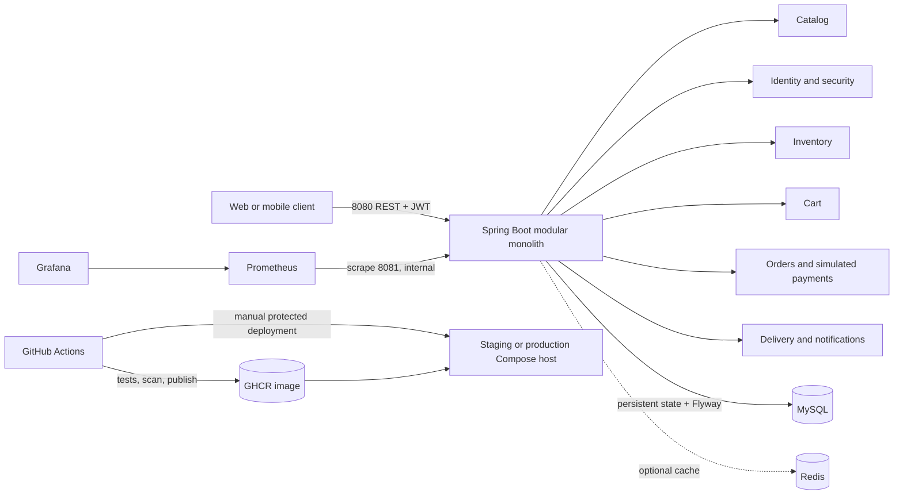

# Runtime architecture

The first release is a modular monolith. One Spring Boot process owns the catalog, identity, inventory, cart, order/payment simulation, delivery, and notification modules. Business state and Flyway migrations live in MySQL; Redis is an optional short-lived catalog cache. Module calls remain in-process so checkout, stock reservation, payment simulation, and notification writes can use local transactions.

The application exposes user APIs on port 8080 and management health/metrics on port 8081, bound to loopback by default. Compose makes the management port reachable only on its internal network. The deployment workflow is manually dispatched and requires environment-specific GitHub secrets and reviewer protection for each environment. It deploys immutable SHA or semantic-version tags and smoke-checks health with rollback to the prior image on failure.

## Operational signals

- `/actuator/health` reports readiness/liveness details; `/actuator/prometheus` exports Micrometer metrics on the management listener.
- Prometheus scrapes the internal management endpoint; Grafana is provisioned with the Prometheus data source and application dashboard.
- Console logs use Logstash-compatible structured JSON for centralized collection.
- The k6 smoke scenario is an optional, explicitly triggered check against a deployed catalog endpoint; it creates no records.

## Deferred boundaries

Kafka, external payment/email/SMS providers, microservice extraction, Kubernetes, and cloud infrastructure are intentionally outside this local modular-monolith delivery. Add them when deployment needs and traffic measurements justify the operational cost.
