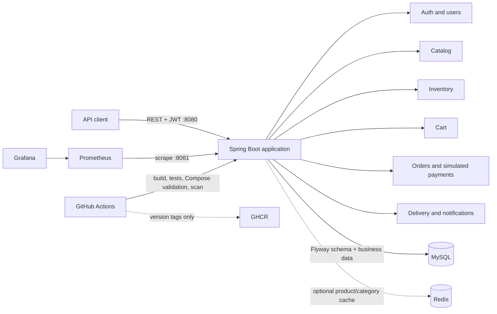

# Runtime architecture

Zepto Clone runs as one Spring Boot process. Modules call one another in-process, and MySQL owns business state. This keeps checkout and inventory changes inside local transactions while the project has one service and one store.

The HTTP layer validates requests and maps them to DTOs. Services own business rules and transaction boundaries; repositories handle persistence. Hibernate runs with schema validation, while Flyway migrations are the schema history. Prices use decimal types and order items keep a snapshot of product details at checkout.

Inventory reservations use a conditional SQL update so checking availability and increasing the reserved count happen together. Checkout coordinates cart validation, reservation, order creation, and payment simulation inside the application. Redis only caches catalog reads; it is never authoritative for stock, users, or orders.

The application API listens on port 8080. Health and Prometheus metrics use port 8081, bound to loopback by default. Compose exposes the management listener only to its internal network.

## Operations

- `/actuator/health` supplies health and probe status; `/actuator/prometheus` exposes Micrometer metrics.
- Prometheus scrapes the management listener. Grafana provisions a Prometheus data source and a project dashboard.
- Logs use Spring's Logstash-compatible structured console format.
- CI builds and scans the image. A version tag is required to publish it to GHCR.
- Deployment is a separate manual workflow. It targets a protected `staging` or `production` environment, checks health, and attempts to restore the prior image if the new one fails.

## Boundaries

Payments, courier updates, and notifications are simulations or in-app records. A real provider would introduce network failure and retry behavior; it should not be called while holding the current checkout transaction. A transactional outbox would be a reasonable next step if those integrations become necessary. Multi-store inventory, Kafka, service extraction, Kubernetes, and cloud infrastructure are not part of this release.
